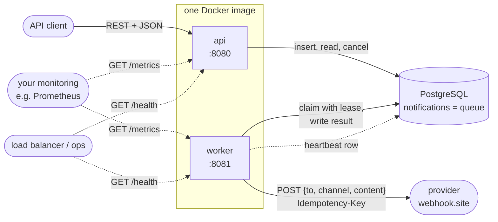

# Notification Service

A Go service that accepts SMS, email and push notifications over a REST API and delivers them to an external provider. It can send one at a time or in batches of up to 1,000, at most 100 per second per channel, with three priority levels, retries with backoff and a circuit breaker. Every notification's status and attempt history can be read back. PostgreSQL is the only datastore and also the work queue. The API and the worker are two processes built from one Docker image; both expose Prometheus metrics and a health endpoint.

**Highlights**
- **Rate limit proven where it counts:** a fake provider measures arrivals and never sees more than 100 per second per channel (`make load`). A fake-time unit test proves the limiter itself.
- **Failures handled by cause:** only problems that could be about the message use an attempt (429s and our own config errors give it back), and a per-channel circuit breaker and 429 pause stop sending into an outage.
- **Race-safe idempotency:** a unique key plus a hash of the request on creation, and an `Idempotency-Key` header on every delivery attempt.
- **Weighted priority without starvation:** 70/20/10 smooth round-robin per channel. In the load test, `high` was created last and finished first.
- **Tests against real Postgres:** concurrent claims, stale lease writes, deadlock-free batches. Fake-time tests cover the limiter and breaker, and every API response is checked against the OpenAPI spec.
- **Observable:** metrics per process, and a `/health` that reports worker breakers and pauses through a database heartbeat.



## Quick start

You need Docker with Compose **v2.24 or newer** (the compose file uses `env_file` with `required: false`). The old hyphenated `docker-compose` (v1) is not supported.

1. **Create a webhook.site URL** (it plays the provider). Open <https://webhook.site>, click **Edit**, and set:
   - **Status code:** `202`
   - **Content type:** `application/json`
   - **Response body:** `{"messageId": "3f1c2b8e-1d2a-4c4b-9e3f-0a1b2c3d4e5f", "status": "accepted", "timestamp": "2026-01-01T00:00:00Z"}`

   A fixed body is fine: the worker stores `messageId` when it is there and counts any 2xx as sent.
2. **Configure and start:**
   ```sh
   cp .env.example .env
   # edit .env: set PROVIDER_URL to your webhook.site URL
   docker compose up --build        # or: make up  (same, in the background)
   ```
   Compose starts Postgres, runs the migrations once, then starts `api` (port 8080) and `worker` (port 8081). If a port is taken, set `API_PORT` / `WORKER_PORT` in `.env`.
3. **Check it:** `curl localhost:8080/health` should say `"status":"ok"`. Swagger UI is at <http://localhost:8080/docs>.

Free webhook.site URLs are slow (about 4.3 s per request in our runs) and rate-limited, so they can't show 100 messages per second; use [`make load`](#load-test) for that. `make` lists every target: `up`, `down`, `logs`, `test`, `test-short`, `load`, `build`.

## API walkthrough

The full contract is in [`api/openapi.yaml`](api/openapi.yaml), also served at `GET /openapi.yaml` and as Swagger UI at `GET /docs`. Responses below are from a real run, shortened with `…`; use the IDs from your own responses in the later calls. Errors are RFC 9457 `application/problem+json`. Every response carries `X-Correlation-ID`: the client's value if valid (1–128 characters of `[A-Za-z0-9-]`), otherwise a generated one.

**Create a notification.** `channel` is `sms`, `email` or `push`; `priority` is `high`, `normal` (default) or `low`.

```sh
curl -i -X POST localhost:8080/notifications \
  -H 'Content-Type: application/json' -H 'X-Correlation-ID: demo-1' \
  -d '{"recipient": "+905551234567", "channel": "sms", "content": "Your code is 4821",
       "priority": "high", "idempotency_key": "order-1001-sms"}'
```
```
HTTP/1.1 201 Created
Location: /notifications/01a1e03a-0415-775c-90ef-93c0a26b21f4
X-Correlation-Id: demo-1

{"id":"01a1e03a-0415-775c-90ef-93c0a26b21f4","batch_id":null,"channel":"sms","recipient":"+905551234567",
 "content":"Your code is 4821","priority":"high","idempotency_key":"order-1001-sms","correlation_id":"demo-1",
 "status":"pending","attempts":0,"max_attempts":6,"next_attempt_at":"2026-11-15T17:21:00.949942Z", …,
 "sms":{"encoding":"gsm7","segments":1}}
```

**Get it, with its delivery attempts.**

```sh
curl localhost:8080/notifications/01a1e03a-0415-775c-90ef-93c0a26b21f4
```
```json
{"id":"01a1e03a-0415-775c-90ef-93c0a26b21f4", …, "status":"sent","attempts":1,"next_attempt_at":null,
 "last_error":null,"provider_message_id":"f25a2cdb-3e50-49d4-a89f-07bce4d99cc0", …,
 "delivery_attempts":[{"attempt_no":1,"started_at":"2026-11-15T17:21:01.03589Z","duration_ms":52,
                       "http_status":202,"outcome":"success","error":null}]}
```

`status` is one of `pending`, `processing`, `sent`, `failed`, `cancelled`. A notification waiting for a retry is `pending` with `attempts > 0`.

**Invalid input** returns 422 with every problem listed:

```sh
curl -X POST localhost:8080/notifications -H 'Content-Type: application/json' \
  -d '{"recipient": "not-a-phone", "channel": "sms", "content": ""}'
```
```json
{"type":"/problems/validation-failed","title":"Validation failed","status":422, …,
 "errors":[{"field":"recipient","message":"must be an E.164 phone number, e.g. +905551234567"},
           {"field":"content","message":"is required"}]}
```

**Schedule a send.** Add `scheduled_at` (RFC 3339 with an offset) to a single create or to any batch item:

```sh
# use a time within the next 30 days
curl -X POST localhost:8080/notifications -H 'Content-Type: application/json' \
  -d '{"recipient": "+905551234567", "channel": "sms", "content": "Your appointment is tomorrow at 10:00",
       "scheduled_at": "2026-11-20T09:00:00+03:00"}'
```
```json
{"id":"…", …, "status":"pending","scheduled_at":"2026-11-20T06:00:00Z","attempts":0,"next_attempt_at":"2026-11-20T06:00:00Z", …}
```

- **Window:** a new notification's time must be no more than 1 minute in the past and at most 30 days ahead, on the server's clock. Otherwise the API returns 422 with `scheduled_at` "must be in the future" or "must be at most 30 days ahead".
- **Repeats:** a repeat of an accepted request follows the idempotency rules (200, or 409 for a different time), even after its time has passed.
- **Before it's due:** the notification is `pending` and can be cancelled. It counts as `delayed` in `notification_queue_depth`.
- **When it's due:** it competes by priority and rate like any other notification. A campaign of 10,000 SMS scheduled for 09:00 drains at the channel rate (~99/s), in about 100 s.

**Batch, list, cancel, status, health, metrics:**

```sh
# batch of up to 1,000, all or nothing; the response lists each item's id under "items"
curl -X POST localhost:8080/notifications/batch -H 'Content-Type: application/json' -d '{"items": [
    {"recipient": "+905551234567",    "channel": "sms",   "content": "Sale starts now"},
    {"recipient": "ayse@example.com", "channel": "email", "content": "Your invoice is ready", "priority": "low"},
    {"recipient": "device-token-abc", "channel": "push",  "content": "Order shipped", "priority": "high"}
  ]}'

# newest first; filters: status, channel, batch_id, created_from (inclusive), created_to (exclusive); limit 1–200 (default 50)
curl 'localhost:8080/notifications?status=sent&limit=2'
# the next page: pass next_cursor back unchanged (it is null on the last page)
CURSOR=$(curl -s 'localhost:8080/notifications?status=sent&limit=2' | sed -E 's/.*"next_cursor":"([^"]*)".*/\1/')
curl "localhost:8080/notifications?status=sent&limit=2&cursor=$CURSOR"

curl 'localhost:8080/notifications?channel=email&created_from=2026-01-01T00:00:00Z'

# cancel a pending notification (also one waiting for a retry); cancelling again returns 200
curl -X POST localhost:8080/notifications/01a1e03a-74bd-7a4c-bbd2-ee5713c43ca4/cancel

# batch status = counts per status, e.g. {"total":3,"counts":{"cancelled":0,"failed":0,"pending":0,"processing":0,"sent":3}}
curl localhost:8080/batches/01a1e03a-1e44-7171-a17f-9f8db4c8bc3e
# cancel every pending notification of a batch: {"batch_id":"…","cancelled":2}
curl -X POST localhost:8080/batches/01a1e03a-7548-7bd6-9f68-20d4532df050/cancel

curl localhost:8080/health     # {"status":"ok","checks":{"database":"ok","workers":{"live":1,"channels":{"sms":{"breaker":"closed","paused":false},…}}}}
curl localhost:8080/metrics    # API: HTTP requests, created notifications, queue depth
curl localhost:8081/metrics    # worker: attempts, results, latency, breaker, pause, busy senders
curl localhost:8081/health     # worker liveness
```

**Other answers** (details in `/docs`; all errors are JSON):
- **Same `idempotency_key`, same content → 200** with the stored notification. A batch is 200 if no item is new; repeated items are marked `"duplicate": true`.
- **Same key, different content → 409** `/problems/idempotency-conflict`.
- **400** for malformed JSON, a broken cursor, or an id that isn't a UUID; **415** for a wrong `Content-Type`; **413** for a body over 10 MiB.
- **422** for unknown fields, unknown or repeated query parameters, a reversed time range, or an invalid batch item (named like `items[2].recipient`; the whole batch is rejected).
- **409** `/problems/invalid-state` for cancelling a `processing`, `sent` or `failed` notification.
- **404** for an unknown id or path; **405** with `Allow` for a wrong method.

## How it works

1. **Create.** The API validates the request and inserts one row per notification (`status = pending`, `available_at = now()` or the `scheduled_at` time, plus the correlation ID). With an `idempotency_key` the insert is `ON CONFLICT DO NOTHING`, and an existing row is compared by request hash: same → 200, different → 409. A batch is one transaction, sorted by key.
2. **Dispatch.** Each channel has one dispatcher and 50 sender goroutines. For every send, the dispatcher:
   1. waits for a free sender;
   2. waits while the channel is paused by a 429;
   3. asks the circuit breaker;
   4. takes a rate-limit token;
   5. picks a priority;
   6. claims **one** row;
   7. hands it to the sender.

   If nothing is due, it sleeps `POLL_INTERVAL` (200 ms).
3. **Claim.** In one short transaction, each priority is probed in order with `SELECT … FOR UPDATE SKIP LOCKED LIMIT 1`. The first hit is set to `processing`, its `attempts` goes up by one, and it gets a new `lease_token` and `available_at = now() + 30 s` (the lease). The transaction commits before the provider is called.
4. **Pick a priority.** Smooth weighted round-robin gives exactly 7/2/1 in every 10 claims (`HHNHHLHHNH`). If the picked priority has nothing due, the probe falls back to the others, high first.
5. **Rate limit.** One token bucket per channel, burst 1, paced at **99 % of `RATE_LIMIT_PER_CHANNEL`** (one send about every 10.1 ms).
6. **Send.** The sender posts `{to, channel, content}` with `Idempotency-Key: <notification id>` and the row's correlation ID in its log context. It doesn't follow redirects.
7. **Write the result.** The new status and the attempt row are written in one transaction, `WHERE lease_token = <mine>`:

   | Answer | Result | Uses an attempt? |
   |---|---|---|
   | 2xx | `sent` (stores `messageId`) | – |
   | 5xx, 408, connection refused | `pending` with backoff, then `failed` when attempts run out | yes |
   | timeout or reset after sending | outcome `unknown`, retried with the same key | yes |
   | 429 | `pending` after `Retry-After` (default 30 s, max 5 min); the channel pauses that long | **no** |
   | 3xx, 401, 403, 404 | `pending` after 30 s | **no** |
   | other 4xx | `failed` | yes |

   - **Backoff:** `limit = min(10 min, 10 s × 3^(attempt-1))`, then wait `limit/2 + random(0, limit/2)`. With 6 attempts, the retries take about 8–17 minutes in total.
8. **Breaker.** It opens when, in a rolling 10 s window, at least 20 results are counted and at least half failed; while open, nothing is claimed. After 30 s one probe goes through. Permanent errors, 429s and empty polls don't count.
9. **Crash.** If a worker dies mid-send, the lease expires. The next claim takes the row over directly with a new token, and records the lost attempt as `unknown`; with no attempts left it is failed instead. A late write with the old token changes nothing.
10. **Shutdown.** On SIGTERM the API finishes in-flight requests. The worker stops claiming and lets in-flight sends finish for up to 20 s; the rest are cancelled and written as `unknown` attempts, to be retried. Compose allows 30 s before it kills either process.

**Delivery is at least once.** If the provider accepted a message but its answer was lost, we send it again. Exactly-once over a network is impossible; the `Idempotency-Key` header lets a real provider drop the duplicate.

## Key design decisions

1. **PostgreSQL is the only datastore and the queue.**
   - *Why:* the notification and its queue entry are one row, so there is no dual write and no outbox. 300 msg/s is easy for Postgres, and `SKIP LOCKED`, partial indexes and conditional updates give a reliable queue in one small file we control.
   - *If different:* a separate `jobs` table or Kafka/SQS at much higher volume. We skipped job libraries like River because they bring their own retry logic.
2. **API and worker are separate processes from one image.**
   - *Why:* the API scales with incoming traffic and the worker with the rate limit, and a worker crash can't take the API down. One image keeps the build simple.
   - *If different:* several worker replicas would need a shared limiter and breaker (see limitations).
3. **Leases with lease tokens; at-least-once delivery.**
   - *Why:* a lease means a dead worker's rows come back without a sweeper job, and the token makes a late write harmless. Startup refuses a lease that isn't longer than the provider timeout (30 s > 10 s).
   - *If different:* with a real provider's lookup API, unknown outcomes would be checked before resending.
4. **Idempotency key plus request hash.**
   - *Why:* a unique index lets the database settle concurrent duplicates. The hash of the normalized request tells an honest retry (200) from a client bug (409).
   - *If different:* in a multi-tenant service, keys would be unique per `(tenant_id, idempotency_key)`.
5. **Retry classification, equal-jitter backoff and attempt refunds.**
   - *Why:* jitter spreads retries, so a recovering provider isn't hit all at once. Refunding attempts for 429s and configuration errors means an outage or a bad URL pauses sending instead of failing messages. Attempts are counted at claim time, so a message that crashes the worker can't loop forever.
   - *If different:* per-channel or per-customer retry policies, and an operator endpoint to retry failed messages.
6. **A circuit breaker and a 429 pause per channel.**
   - *Why:* when the provider is failing we stop sending, with one probe every 30 s, instead of using up every message's attempts. A 429 pauses only that channel, and the pause is also written to the rows (`available_at`), so it survives a restart.
   - *If different:* with several replicas, a shared breaker (gobreaker's `DistributedCircuitBreaker`).
7. **Weighted priority, not strict.**
   - *Why:* strict priority would starve `low` for hours during a big `high` campaign. Weighted round-robin keeps `high` fast (≥ 70 % of the rate, 100 % when alone) while everything moves. Each probe uses the claim index with equality on priority, so it stays fast however large the backlog.
   - *If different:* aging, or per-tenant quotas for `high`.
8. **A token bucket with burst 1, paced 1 % under the limit, and one dispatcher per channel.**
   - *Why:* burst 1 spaces sends evenly, where a fixed window allows 2× bursts at its boundary. The limiter controls when sends *start*, but claim and network time shift *arrivals* by a few milliseconds: at exactly 100/s the fake provider saw 101 in one second, and the 1 % headroom absorbs that. One dispatcher enforces every rule in one place; idle, it costs about 5 claim transactions per second per channel (up to 3 small index probes each), instead of 50 senders each polling.
   - *If different:* size the headroom from measured jitter (or set `RATE_LIMIT_PER_CHANNEL` lower); a shared limiter (Postgres or Redis) for several replicas; `LISTEN/NOTIFY` instead of polling.
9. **Cursor pagination on `(created_at, id)`.**
   - *Why:* offset pagination skips or repeats rows while new ones arrive, and gets slower the deeper you go. The keyset cursor is stable and indexed, and opaque and versioned, so its format can change.
   - *If different:* nothing needed at this scale.
10. **Metrics per process, health from a heartbeat.**
    - *Why:* each process exposes its own `/metrics` (the normal Prometheus model). Breakers and pauses live in the worker, so the worker writes a heartbeat row every 5 s and the API's `/health` reads it.
    - *If different:* OpenTelemetry tracing across API, worker and provider; today correlation IDs link the logs.

## Observability

**Metrics.** Labels come only from small fixed sets: channel, priority, status, outcome, state, method and route pattern. They never contain IDs, recipients, URLs or error text, and a test checks this. Both registries also carry Go runtime and process metrics.

| Process | Metric | What it shows |
|---|---|---|
| API | `http_requests_total{method,route,status}` | requests by route pattern (`unmatched` for unknown paths) |
| API | `http_request_duration_seconds{method,route}` | request duration |
| API | `notifications_created_total{channel,priority}` | new notifications (idempotent replays not counted) |
| API | `notification_queue_depth{channel,priority,state}` | unfinished rows: `due`, `delayed`, `processing`; read from the DB at scrape time |
| API | `notification_queue_oldest_due_seconds{channel}` | how long the oldest due row has waited: the "falling behind" signal |
| worker | `notification_attempts_total{channel,priority,outcome}` | attempts by outcome (success, transient, permanent, unknown, channel_wide) |
| worker | `notification_results_total{channel,status}` | final states written: sent, failed |
| worker | `notification_send_duration_seconds{channel}` | one provider call |
| worker | `notification_delivery_latency_seconds{channel,priority}` | created (or scheduled) → sent |
| worker | `notification_claim_duration_seconds{channel}` | one claim transaction |
| worker | `circuit_breaker_state{channel}` | 0 closed, 1 half-open, 2 open |
| worker | `channel_paused{channel}` | 1 while a 429 pause is active |
| worker | `senders_busy{channel}` | sends in flight; shows whether `WORKER_CONCURRENCY` is enough |

**Health.**
- **API `GET /health`:** `down` (503) when the database doesn't answer. `degraded` (200) when no worker has a fresh heartbeat, or a live worker reports a breaker that isn't closed or a paused channel; with the worker stopped it returns `{"status":"degraded","checks":{"database":"ok","workers":{"live":0,"channels":{}}}}`. `ok` (200) otherwise. `degraded` stays 200 on purpose: restarting the API wouldn't fix a worker or provider problem.
- **Worker `GET /health`:** liveness only, 503 while it shuts down. It never touches the database, so a DB outage doesn't get the worker restarted in a loop.

**Logs.** JSON via `log/slog`. The API's correlation ID is stored on each notification and put back into the worker's context, so one search follows a notification from the HTTP request to every delivery attempt. Recipients and content are never logged.

## Testing

`make test` needs **Go 1.27+** and a running Docker. Any Go ≥ 1.21 downloads the 1.27 toolchain automatically (with the default `GOTOOLCHAIN=auto`).

```sh
make test        # go test -race ./... — everything; needs a running Docker
make test-short  # unit tests only, no Docker
```

Integration tests start their own Postgres with testcontainers-go and give each test a fresh database copied from a migrated template, so tests run in parallel and never touch your data. **Colima:** plain `go test` needs `DOCKER_HOST` and `TESTCONTAINERS_DOCKER_SOCKET_OVERRIDE`; `make test` sets both.

| Layer | Where | Examples |
|---|---|---|
| Unit (pure) | `notification/`, `retry/`, `config/`, `worker/` (with fakes) | validation and SMS segments; outcome classification and backoff; priority picker exact counts; dispatcher rules |
| SQL integration | `postgres/` against real Postgres | 12 goroutines claim concurrently, never the same row twice; a stale lease token can't write; 20 concurrent creates with one key give one row; overlapping batches never deadlock; attempts never pass `max_attempts` |
| HTTP API | `httpapi/` with the real handler and Postgres | every status code and rule; every response is validated against `openapi.yaml`, and every operation in the spec is routed |
| End to end | `worker/` with API, Postgres, worker and an httptest provider | 202 → sent; 500 then 202 → retry after backoff; 400 → failed; 429 → no attempt used; timeout → `unknown` then sent; metric values and label safety |

Timing tests use `testing/synctest` (fake time):
- **Rate limit:** endless work for 10 fake seconds gives at most 991 sends at the paced 99/s. They are evenly spaced, and never more than 100 fall in any 1-second window.
- **Breaker:** a half-open breaker that gets an empty poll keeps its probe slot.
- **Claim errors:** back-off doubles up to 5 s.

## Configuration

Every setting is an environment variable with a default, except `DATABASE_URL` and `PROVIDER_URL` (worker only). Invalid combinations stop the process at startup with a clear message.

| Variable | Default | Meaning |
|---|---|---|
| `HTTP_ADDR` | `:8080` | API listen address |
| `SHUTDOWN_TIMEOUT` | `20s` | time for in-flight work on SIGTERM |
| `API_PORT`, `WORKER_PORT` | `8080`, `8081` | host ports (docker compose only) |
| `DATABASE_URL` | – (required) | Postgres URL; compose sets it |
| `DB_MAX_CONNS` | `10` | pool size per process |
| `PROVIDER_URL` | – (worker) | your webhook.site URL |
| `PROVIDER_TIMEOUT` | `10s` | one provider request |
| `LEASE_DURATION` | `30s` | how long a claimed row is reserved; must be > `PROVIDER_TIMEOUT` |
| `POLL_INTERVAL` | `200ms` | idle poll per channel |
| `WORKER_CONCURRENCY` | `50` | senders per channel (Little's law: 100/s × 0.5 s) |
| `PRIORITY_WEIGHTS` | `70,20,10` | high, normal, low shares |
| `RATE_LIMIT_PER_CHANNEL` | `100` | the provider's limit per second; the worker paces at 99 % of it |
| `RETRY_MAX_ATTEMPTS` | `6` | first try + retries |
| `RETRY_BASE`, `RETRY_CAP` | `10s`, `10m` | backoff base and cap |
| `RETRY_AFTER_CAP` | `5m` | longest 429 pause honoured |
| `BREAKER_WINDOW` | `10s` | rolling window |
| `BREAKER_MIN_REQUESTS` | `20` | results needed before the breaker may open |
| `BREAKER_FAILURE_RATIO` | `0.5` | failure share that opens it |
| `BREAKER_OPEN_TIMEOUT` | `30s` | open → one probe; also the requeue delay after a config error |
| `WORKER_HTTP_ADDR` | `:8081` | worker `/health` and `/metrics` |
| `HEARTBEAT_INTERVAL` | `5s` | worker heartbeat; a row expires after 3 intervals |
| `LOG_LEVEL`, `LOG_FORMAT` | `info`, `json` | `debug`/`info`/`warn`/`error`; `json` or `text` |

## Load test

```sh
make load
```

It runs in its own compose project (own database, no host ports, never reads `.env`, always torn down with `down -v`), so it can't clash with a running stack. It sends 3,000 notifications through the batch API, 1,000 per channel; per channel the `low` ones are created first and the `high` ones last. A fake provider answers 202 after 50 ms. Real output:

```
Load test: 3000 notifications (1000 per channel) through POST /notifications/batch.
Per channel the low ones were created first and the high ones last (334 low, 333 normal, 333 high); all created in 33ms.

All 3000 sent 10.6s after the first batch.

  channel  received  throughput/s  peak in any 1s window  limit
      sms      1000          99.0                    100    100
    email      1000          99.0                    100    100
     push      1000          98.9                    100    100
(measured by the fake provider as requests arrive; the worker paces at 99% of the limit)

  priority  count   p50    p95
      high    999  2.5s   4.6s
    normal    999  5.7s   7.4s
       low   1002  8.5s  10.0s
(delivery latency = sent - created_at, all channels; weights 70/20/10)

PASS: every channel's peak is <= 100 per second.
```

- **Why a fake provider:** webhook.site took about 4.3 s per request in our runs (about 12 msg/s with 50 senders), and free URLs are rate-limited. The fake provider (`cmd/fakeprovider`) is used only here.
- **The rate limit is proved twice:** the synctest unit test proves the limiter logic at the source, and the load test measures at the receiving side. The fake provider records arrivals, and `make load` fails if any channel's peak in a 1-second sliding window is over `RATE_LIMIT_PER_CHANNEL`.
- **Priority:** `high` was created last but finished first (p50 2.5 s vs 8.5 s for `low`).

## Limitations and next steps

- **One worker replica.** The limiter and breakers live in the worker's memory. To run several replicas, either share the limiter (in Postgres or Redis) and use gobreaker's `DistributedCircuitBreaker`, or elect one leader per channel with a hot standby; leader election has to handle a lost lock.
- **Unknown outcomes are resent.** A real provider's lookup API would let us reconcile them first. webhook.site has none, so we rely on the `Idempotency-Key` header.
- **Idempotency keys are global.** A multi-tenant service would make them unique per `(tenant_id, idempotency_key)`.
- **No authentication.** A real service would use per-client API keys. `/metrics` has no auth and belongs on an internal network only.
- **Priority inflation.** Clients choose `priority`, so everyone could send `high`. The fixes would be per-tenant quotas for `high`, or deriving priority from the message type. The `priority` metric label makes inflation visible.
- **SMS encoding.** Any character outside the GSM-7 alphabet (e.g. Turkish ş/ğ/ı, Polish ą/ł, Cyrillic, Arabic, emoji) switches the whole SMS to UCS-2 (70 chars per segment instead of 160). We count this correctly. Not built: GSM national language shift tables (Turkish, Spanish, Portuguese, Indian languages), which would keep e.g. Turkish text at 7 bits and cut cost.
- **Polling.** The worker polls every 200 ms when idle. `LISTEN/NOTIFY` would remove that delay.
- **One table for messages and the queue.** At very high volume, a separate `jobs` table would keep the hot queue small.
- **Tracing.** No OpenTelemetry yet; correlation IDs link the logs today.
- **Not built:** templates, WebSocket status updates, and CI.
