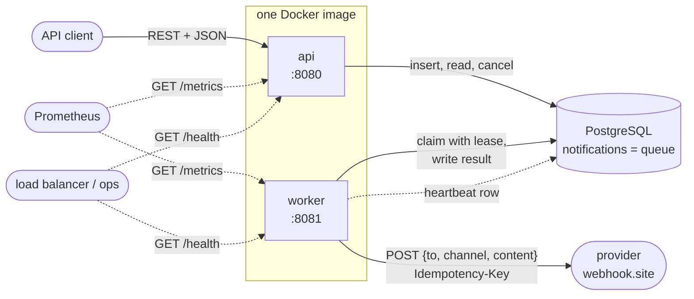

# Notification Service

A Go service that accepts SMS, email and push notifications over a REST API and delivers them to an external provider. Notifications can be sent one at a time or in batches of up to 1,000. Delivery is rate-limited to 100 messages per second per channel, with three priority levels. Failed sends are retried with backoff, and a circuit breaker protects the provider. Every notification's status and attempt history can be read back. PostgreSQL is the only datastore and also the work queue. The API and the worker are two processes built from one Docker image. Both expose Prometheus metrics and a health endpoint.



## Contents

1. [Quick start](#quick-start)
2. [API walkthrough](#api-walkthrough)
3. [How it works](#how-it-works)
4. [Key design decisions](#key-design-decisions)
5. [Observability](#observability)
6. [Testing](#testing)
7. [Configuration](#configuration)
8. [Load test](#load-test)
9. [Limitations and next steps](#limitations-and-next-steps)

## Quick start

You need Docker with Compose v2.

1. **Create a webhook.site URL** (it plays the provider). Open <https://webhook.site>; you get a unique URL. Click **Edit** at the top and set:
   - **Status code:** `202`
   - **Content type:** `application/json`
   - **Response body:**
     ```json
     {"messageId": "3f1c2b8e-1d2a-4c4b-9e3f-0a1b2c3d4e5f", "status": "accepted", "timestamp": "2026-01-01T00:00:00Z"}
     ```
     A fixed body is fine: the worker stores `messageId` when it is there and counts any 2xx as sent.
2. **Configure and start:**
   ```sh
   cp .env.example .env
   # edit .env: set PROVIDER_URL to your webhook.site URL
   docker compose up --build        # or: make up  (same, in the background)
   ```
   Compose starts Postgres, runs the migrations once, then starts `api` (port 8080) and `worker` (port 8081). If 8080 or 8081 is taken, set `API_PORT` / `WORKER_PORT` in `.env`.
3. **Check it:** `curl localhost:8080/health` should say `"status":"ok"`. Swagger UI is at <http://localhost:8080/docs>.

**Note:** free webhook.site URLs are slow (about 4.3 s per request in our runs) and rate-limited, so they can't show 100 messages per second. Use [`make load`](#load-test) for throughput. If webhook.site answers 429, the worker pauses that channel and retries later without using up attempts.

`make` lists every target: `up`, `down`, `logs`, `test`, `test-short`, `load`, `build`.

## API walkthrough

The full contract is in [`api/openapi.yaml`](api/openapi.yaml), also served at `GET /openapi.yaml` and as Swagger UI at `GET /docs`. Errors use RFC 9457 `application/problem+json`. Every response carries an `X-Correlation-ID` header: the client's value is kept if it is valid (1–128 characters of `[A-Za-z0-9-]`), otherwise the API generates one. The responses below come from a real run; long ones are shortened with `…`. Use the IDs from your own responses in the later calls.

### Create a notification

```sh
curl -i -X POST localhost:8080/notifications \
  -H 'Content-Type: application/json' -H 'X-Correlation-ID: demo-1' \
  -d '{"recipient": "+905551234567", "channel": "sms", "content": "Your code is 4821",
       "priority": "high", "idempotency_key": "order-1001-sms"}'
```
```
HTTP/1.1 201 Created
Location: /notifications/01a1e03a-0415-775c-90ef-93c0a26b21f4
X-Correlation-Id: demo-1

{"id":"01a1e03a-0415-775c-90ef-93c0a26b21f4","batch_id":null,"channel":"sms","recipient":"+905551234567",
 "content":"Your code is 4821","priority":"high","idempotency_key":"order-1001-sms","correlation_id":"demo-1",
 "status":"pending","scheduled_at":null,"attempts":0,"max_attempts":6,"next_attempt_at":"2026-11-15T17:21:00.949942Z",
 "last_error":null,"provider_message_id":null,"created_at":"2026-11-15T17:21:00.949942Z", …,
 "sms":{"encoding":"gsm7","segments":1}}
```

- **Fields:** `channel` is `sms`, `email` or `push`; `priority` is `high`, `normal` (default) or `low`.
- **Recipient rules:** `sms` needs an E.164 number, `email` a plain address, `push` a device token.
- **SMS info:** SMS responses include the encoding and segment count. `"Şifreniz: 4821"` gives `{"encoding":"ucs2","segments":1}`.
- **Idempotency:**
  - Sending the same body again with the same `idempotency_key` returns **200** with the stored notification. Nothing new is created.
  - Reusing the key with different content returns **409**:

```json
{"type":"/problems/idempotency-conflict","title":"Idempotency key reused","status":409,
 "detail":"This idempotency_key was already used for a different notification.",
 "correlation_id":"01a1e03a-0437-7469-b54b-78a3236c2be1",
 "errors":[{"field":"idempotency_key","message":"was already used with different content"}]}
```

Invalid input returns **422** with every problem listed:

```sh
curl -X POST localhost:8080/notifications -H 'Content-Type: application/json' \
  -d '{"recipient": "not-a-phone", "channel": "sms", "content": ""}'
```
```json
{"type":"/problems/validation-failed","title":"Validation failed","status":422,
 "detail":"The request breaks one or more rules; see errors.", "correlation_id":"…",
 "errors":[{"field":"recipient","message":"must be an E.164 phone number, e.g. +905551234567"},
           {"field":"content","message":"is required"}]}
```

Malformed JSON is a 400 and unknown fields are a 422. A wrong `Content-Type` is a 415, and a body over 10 MiB is a 413.

### Create a batch (up to 1,000)

```sh
curl -X POST localhost:8080/notifications/batch -H 'Content-Type: application/json' -d '{"items": [
    {"recipient": "+905551234567",    "channel": "sms",   "content": "Sale starts now"},
    {"recipient": "ayse@example.com", "channel": "email", "content": "Your invoice is ready", "priority": "low"},
    {"recipient": "device-token-abc", "channel": "push",  "content": "Order shipped", "priority": "high"}
  ]}'
```
```json
{"batch_id":"01a1e03a-1e44-7171-a17f-9f8db4c8bc3e",
 "items":[{"index":0,"id":"01a1e03a-1e44-7173-9ee7-dc95d05e5525","status":"pending","duplicate":false,"batch_id":"01a1e03a-1e44-7171-a17f-9f8db4c8bc3e"},
          {"index":1,"id":"01a1e03a-1e44-7188-865a-438d7d8dda02","status":"pending","duplicate":false,"batch_id":"…"},
          {"index":2,"id":"01a1e03a-1e44-718b-ba4e-dde8429bbe4b","status":"pending","duplicate":false,"batch_id":"…"}]}
```

- **All or nothing:** one invalid item rejects the whole batch with a 422 that names each failing item, e.g. `items[2].recipient`.
- **Status codes:** **201** if at least one item is new, **200** if every item was already stored.
- **Duplicates:** items whose `idempotency_key` already exists with the same content are returned with `"duplicate": true`.

### Get one notification, with its delivery attempts

```sh
curl localhost:8080/notifications/01a1e03a-0415-775c-90ef-93c0a26b21f4
```
```json
{"id":"01a1e03a-0415-775c-90ef-93c0a26b21f4", …, "status":"sent","attempts":1,"max_attempts":6,
 "next_attempt_at":null,"last_error":null,"provider_message_id":"f25a2cdb-3e50-49d4-a89f-07bce4d99cc0",
 "created_at":"2026-11-15T17:21:00.949942Z","updated_at":"2026-11-15T17:21:01.088062Z",
 "sms":{"encoding":"gsm7","segments":1},
 "delivery_attempts":[{"attempt_no":1,"started_at":"2026-11-15T17:21:01.03589Z","duration_ms":52,
                       "http_status":202,"outcome":"success","error":null}]}
```

`status` is one of `pending`, `processing`, `sent`, `failed`, `cancelled`. A notification waiting for a retry is `pending`, with `attempts > 0` and `next_attempt_at` in the future.

### List with filters and a cursor

```sh
curl 'localhost:8080/notifications?status=sent&limit=2'
```
```json
{"data":[{"channel":"push","status":"sent", …},{"channel":"email","status":"sent", …}],
 "next_cursor":"eyJ2IjoxLCJ0IjoiMjAyNi0xMS0xNVQxNzoyMTowNy42NTIxOTlaIiwiaWQiOiIwMWExZTAzYS0xZTQ0LTcxODgtODY1YS00MzhkN2Q4ZGRhMDIifQ"}
```
```sh
# the next page: pass next_cursor back unchanged (it is null on the last page)
CURSOR=$(curl -s 'localhost:8080/notifications?status=sent&limit=2' | sed -E 's/.*"next_cursor":"([^"]*)".*/\1/')
curl "localhost:8080/notifications?status=sent&limit=2&cursor=$CURSOR"

curl 'localhost:8080/notifications?channel=email&created_from=2026-01-01T00:00:00Z'
```

- **Order:** newest first.
- **Filters:** `status`, `channel`, `batch_id`, `created_from` (inclusive) and `created_to` (exclusive). `limit` is 1–200, default 50.
- **Errors:** an unknown or repeated parameter is a 422, e.g. `?stauts=sent` returns `"errors":[{"field":"stauts","message":"is not a known query parameter"}]`. A reversed time range is also a 422. A damaged cursor is a 400.

### Cancel

```sh
curl -X POST localhost:8080/notifications/01a1e03a-74bd-7a4c-bbd2-ee5713c43ca4/cancel
```
```json
{"id":"01a1e03a-74bd-7a4c-bbd2-ee5713c43ca4", …, "status":"cancelled","next_attempt_at":null, …}
```

- **What can be cancelled:** only `pending` notifications, including ones waiting for a retry.
- **Repeating it:** cancelling again returns 200 with the same body.
- **Too late:** a notification that is `processing`, `sent` or `failed` returns 409:

```json
{"type":"/problems/invalid-state","title":"Notification can't be cancelled","status":409,
 "detail":"The notification is sent; only pending notifications can be cancelled.","correlation_id":"…"}
```

### Batch status and batch cancel

```sh
curl localhost:8080/batches/01a1e03a-1e44-7171-a17f-9f8db4c8bc3e
```
```json
{"batch_id":"01a1e03a-1e44-7171-a17f-9f8db4c8bc3e","total":3,
 "counts":{"cancelled":0,"failed":0,"pending":0,"processing":0,"sent":3}}
```
```sh
curl -X POST localhost:8080/batches/01a1e03a-7548-7bd6-9f68-20d4532df050/cancel
```
```json
{"batch_id":"01a1e03a-7548-7bd6-9f68-20d4532df050","cancelled":2}
```

A batch has no status of its own: its status is the count of its notifications in each state. Batch cancel cancels every notification in it that is still `pending` and reports how many.

### Health and metrics

```sh
curl localhost:8080/health
```
```json
{"status":"ok","checks":{"database":"ok","workers":{"live":1,"channels":{
  "email":{"breaker":"closed","paused":false},"push":{"breaker":"closed","paused":false},"sms":{"breaker":"closed","paused":false}}}}}
```

With the worker stopped, the same call returns `{"status":"degraded","checks":{"database":"ok","workers":{"live":0,"channels":{}}}}`.

```sh
curl localhost:8080/metrics    # API: HTTP, created notifications, queue depth
curl localhost:8081/metrics    # worker: attempts, results, latency, breaker, rate-limit pause
curl localhost:8081/health     # worker liveness
```
```
http_requests_total{method="POST",route="POST /notifications",status="201"} 2
http_requests_total{method="POST",route="POST /notifications",status="409"} 1
notification_queue_depth{channel="sms",priority="high",state="due"} 0
circuit_breaker_state{channel="sms"} 0
senders_busy{channel="sms"} 0
```

## How it works

- **The table is the queue.**
  - Each notification row is also its queue entry; `available_at` says when it may be sent.
  - The worker claims a due row with `SELECT … FOR UPDATE SKIP LOCKED` in a short transaction. The transaction sets the row to `processing` with a new `lease_token` and a lease of 30 s, then commits *before* the provider is called.
  - No transaction is ever open during the HTTP call.
  - If a worker dies, its lease expires and the row is claimed again; that lost attempt is recorded as `unknown`.
  - A result is written only `WHERE lease_token = <mine>`, so a late worker can't overwrite a row that was taken over.
- **One dispatcher and a pool of senders per channel.** Each channel (sms, email, push) has one dispatcher and 50 sender goroutines. For every send, the dispatcher does these steps in order:
  1. Wait for a free sender.
  2. Wait while the channel is paused by a 429.
  3. Ask the circuit breaker for permission.
  4. Take a rate-limit token.
  5. Pick a priority.
  6. Claim **one** row.
  7. Hand it to the free sender.

  The token is taken *before* the claim, so a lease only covers the send itself. If nothing is due, the dispatcher sleeps 200 ms.
- **Priority 70/20/10.**
  - Each claim picks `high`, `normal` or `low` with smooth weighted round-robin (the nginx algorithm). Every 10 claims give exactly 7/2/1, spread out as `HHNHHLHHNH`.
  - If the picked priority has nothing due, the claim falls back to the others, high first, so no slot is wasted.
  - `high` gets at least 70 % of a channel's rate and `low` never starves.
- **Rate limit.**
  - One token bucket per channel with burst 1, paced at **99 % of `RATE_LIMIT_PER_CHANNEL`**, so one send starts about every 10.1 ms.
  - The 1 % headroom exists because the limiter controls when sends *start*. Claim and network time then shift *arrivals* by a few milliseconds. At exactly 100/s the provider saw 101 requests within one second in our load test; at 99 % it sees at most 100.
  - A real deployment would size this margin from its measured jitter, or set `RATE_LIMIT_PER_CHANNEL` a little below the provider's limit.
- **Retries and backoff.** Every provider answer is classified:

  | Answer | Effect | Uses an attempt? |
  |---|---|---|
  | 2xx | `sent` | – |
  | 5xx, 408, connection refused | retry with backoff | yes |
  | timeout or reset after the request was sent | outcome `unknown`, retry with the same idempotency key | yes |
  | 429 | pause the whole channel for `Retry-After` (default 30 s, capped at 5 min), row back to `pending` | **no** |
  | 3xx, 401, 403, 404 (our configuration is wrong) | row back to `pending` for 30 s | **no** |
  | other 4xx | `failed` right away | yes |

  - **Backoff:** exponential with equal jitter: `limit = min(10 min, 10 s × 3^(attempt-1))`, then wait `limit/2 + random(0, limit/2)`. Default is 6 attempts (the first try plus 5 retries), so the total retry window is about 8–17 minutes.
  - **Refunds:** only problems that could be about *this* message use an attempt.
  - **Crashes:** a crash still uses one, because attempts are counted at claim time.
- **Circuit breaker per channel** (`sony/gobreaker` v2):
  - It opens when, in a rolling 10 s window, at least 20 results are counted and at least 50 % of them failed.
  - After 30 s it lets one probe through.
  - Permanent errors, 429s and empty polls are excluded, because they say nothing about the provider's health.
  - While open, the channel doesn't claim anything.
- **Idempotency, twice.**
  - **On creation:** an optional `idempotency_key` is unique in the table. The API also stores a SHA-256 of the normalized request, so a repeat with the same content returns the stored row and different content returns 409.
  - **On delivery:** every provider request carries `Idempotency-Key: <notification id>`, the same value on every attempt.
- **Delivery is at least once.** Exactly-once over a network is impossible: if the provider accepted a message but its answer was lost (timeout, crash), we send it again. The `Idempotency-Key` header lets a real provider drop that duplicate.
- **Graceful shutdown.**
  - On SIGTERM the API stops accepting requests and finishes the ones in flight.
  - The worker stops claiming and lets in-flight sends finish for up to `SHUTDOWN_TIMEOUT` (20 s). Sends still running after that are cancelled and written as `unknown` attempts, to be retried.
  - Compose gives both processes 30 s before it kills them.

## Key design decisions

1. **PostgreSQL is the only datastore and the queue.**
   - *Why:* the notification and its queue entry are one row, so there is no dual write and no outbox. At most 300 msg/s is easy for Postgres. `SKIP LOCKED`, partial indexes and conditional updates give a reliable queue in about 100 lines we control.
   - *If different:* at much higher volume, a separate `jobs` table or Kafka/SQS. For our own retry design we skipped job libraries like River, which bring their own retry logic.
2. **API and worker are separate processes from one image.**
   - *Why:* the API scales with incoming traffic and the worker with the rate limit. A worker crash can't take the API down, and one image keeps builds simple.
   - *If different:* with several worker replicas, the per-channel limiter and breaker would need shared state (see limitations).
3. **Leases with lease tokens; at-least-once delivery.**
   - *Why:* a lease (`available_at` = lease expiry) means a dead worker's rows come back without a sweeper. The token makes a late write harmless. The lease (30 s) must be longer than the provider timeout (10 s), and startup checks that.
   - *If different:* with a provider that has a lookup API, unknown outcomes would be checked there before resending.
4. **Idempotency key plus request hash.**
   - *Why:* the unique index makes concurrent duplicates race-safe; the database decides. The hash of the normalized request tells an honest retry (same content, 200) from a client bug (same key, other content, 409).
   - *If different:* with several tenants, the key would be unique per `(tenant_id, idempotency_key)`.
5. **Retry classification, equal-jitter backoff and attempt refunds.**
   - *Why:* jitter spreads retries so a recovering provider isn't hit all at once. Refunding attempts for 429s and configuration errors means an outage or a bad URL pauses sending instead of failing messages.
   - *If different:* per-channel or per-customer retry policies, and an operator endpoint to retry failed messages.
6. **A circuit breaker and a 429 pause per channel.**
   - *Why:* when the provider is failing, we stop sending (one probe every 30 s) instead of using up every message's attempts. A 429 pauses only that channel, for as long as the provider asks. The pause is stored on the rows too (`available_at`), so it survives a restart.
   - *If different:* with several replicas, a shared breaker (gobreaker's `DistributedCircuitBreaker`).
7. **Weighted priority, not strict.**
   - *Why:* strict priority would starve `low` for hours during a large `high` campaign. Weighted round-robin keeps `high` fast (≥ 70 % of the rate, 100 % when it's alone) while everything moves. Each probe uses the claim index with equality on priority, so it stays fast however large the backlog.
   - *If different:* aging, or per-tenant quotas for `high`.
8. **A token bucket with burst 1, and one dispatcher per channel.**
   - *Why:* burst 1 spaces sends evenly, unlike a fixed window, which allows bursts of 2× the rate at the window boundary. One dispatcher enforces every rule (pause, breaker, token, priority, claim) in one place. When idle it costs about 5 queries per second per channel, instead of 50 senders each polling on their own.
   - *If different:* a shared limiter (Postgres or Redis) for several replicas, and `LISTEN/NOTIFY` to drop the 200 ms poll.
9. **Cursor pagination on `(created_at, id)`.**
   - *Why:* offset pagination skips or repeats rows while new ones arrive, and gets slower the deeper you page. The keyset cursor is stable and uses an index. The cursor is opaque and versioned (`{"v":1,…}` in base64url), so its format can change.
   - *If different:* nothing needed at this scale.
10. **Metrics per process, health from a heartbeat.**
    - *Why:* each process exposes its own `/metrics` (the normal Prometheus model). Breakers and pauses live in the worker, so the worker writes a heartbeat row every 5 s, and the API's `/health` reads it.
    - *If different:* OpenTelemetry tracing across API, worker and provider. Today the correlation ID links them in the logs.

## Observability

**Metrics.** Labels only come from small fixed sets: channel, priority, status, outcome, state, method and route pattern. They never contain IDs, recipients, URLs or error text, and a test checks this.

| Process | Metric | What it shows |
|---|---|---|
| API | `http_requests_total{method,route,status}` | requests by route pattern (`unmatched` for unknown paths) |
| API | `http_request_duration_seconds{method,route}` | request duration |
| API | `notifications_created_total{channel,priority}` | new notifications (idempotent replays not counted) |
| API | `notification_queue_depth{channel,priority,state}` | unfinished rows: `due`, `delayed` (backoff), `processing`; read from the DB at scrape time |
| API | `notification_queue_oldest_due_seconds{channel}` | how long the oldest due row has waited: the "falling behind" signal |
| worker | `notification_attempts_total{channel,priority,outcome}` | attempts: success, transient, permanent, unknown, channel_wide |
| worker | `notification_results_total{channel,status}` | final states written: sent, failed |
| worker | `notification_send_duration_seconds{channel}` | one provider call |
| worker | `notification_delivery_latency_seconds{channel,priority}` | created (or scheduled) → sent |
| worker | `notification_claim_duration_seconds{channel}` | one claim transaction |
| worker | `circuit_breaker_state{channel}` | 0 closed, 1 half-open, 2 open |
| worker | `channel_paused{channel}` | 1 while a 429 pause is active |
| worker | `senders_busy{channel}` | sends in flight; shows whether `WORKER_CONCURRENCY` is enough |

Both registries also include the Go runtime and process collectors.

**Health.**
- **API `GET /health`:**
  - `down` (**503**): the database doesn't answer.
  - `degraded` (**200**): no worker has a fresh heartbeat, or a live worker reports a breaker that isn't closed or a paused channel.
  - `ok` (**200**): otherwise.
  - `degraded` stays 200 on purpose: restarting the API wouldn't fix a worker or provider problem.
- **Worker `GET /health`:** a liveness check only, 503 while it shuts down. It doesn't touch the database, so a DB outage doesn't get the worker restarted in a loop.

**Logs and correlation IDs.**
- **Format:** both processes log JSON with `log/slog`.
- **Correlation ID:** the API's `X-Correlation-ID` is stored on each notification, and the worker puts it back into the context before sending. One search finds a notification's whole path, from the HTTP request to every delivery attempt.
- **Privacy:** recipients and content are never logged.

## Testing

```sh
make test        # go test -race ./... — everything; needs a running Docker
make test-short  # unit tests only, no Docker
```

Integration tests start their own Postgres with testcontainers-go:
- one container per test package;
- the migrations run once into a template database;
- each test gets a fresh copy (`CREATE DATABASE … TEMPLATE`), so tests run in parallel and never touch your data.

`KEEP_TEST_DB=1` keeps the container and logs a `psql` connection string for debugging.

**Colima:** plain `go test` needs `DOCKER_HOST` and `TESTCONTAINERS_DOCKER_SOCKET_OVERRIDE`. `make test` sets both when Colima is the active Docker context.

There are four layers.

| Layer | Where | Examples |
|---|---|---|
| Unit (pure) | `notification/`, `retry/`, `config/`, `worker/` (with fakes) | validation and SMS segments; outcome classification and backoff; priority picker exact counts; dispatcher rules |
| SQL integration | `postgres/` against real Postgres | 12 goroutines claim concurrently, never the same row twice; a stale lease token can't write; 20 concurrent creates with one key give one row; overlapping batches never deadlock; attempts never pass `max_attempts` |
| HTTP API | `httpapi/` with the real handler and Postgres | every status code and rule; every response is validated against `openapi.yaml` (kin-openapi), and every operation in the spec is routed |
| End to end | `worker/` with API, Postgres, worker and an httptest provider | 202 → sent; 500 then 202 → retry after backoff; 400 → failed; 429 → no attempt used; timeout → `unknown` then sent; metric values and label safety |

What the timing tests prove (with `testing/synctest` fake time):
- **Rate limit:** endless work for 10 fake seconds gives at most 991 sends at the paced 99/s. They are evenly spaced, and never more than 100 fall in any 1-second window.
- **Breaker:** a half-open breaker that gets an empty poll keeps its probe slot.
- **Claim errors:** back-off doubles up to 5 s.

Several tests were checked by breaking the code on purpose: removing the row lock, using burst 10, and reporting empty claims as successes each make a test fail.

## Configuration

Everything is an environment variable with a default except `DATABASE_URL` and `PROVIDER_URL` (worker only). Invalid combinations stop the process at startup with a clear message, e.g. a lease not longer than the provider timeout.

| Variable | Default | Meaning |
|---|---|---|
| `HTTP_ADDR` | `:8080` | API listen address |
| `SHUTDOWN_TIMEOUT` | `20s` | time for in-flight work on SIGTERM |
| `API_PORT`, `WORKER_PORT` | `8080`, `8081` | host ports (docker compose only) |
| `DATABASE_URL` | – (required) | Postgres URL; compose sets it |
| `DB_MAX_CONNS` | `10` | pool size per process |
| `PROVIDER_URL` | – (worker) | your webhook.site URL |
| `PROVIDER_TIMEOUT` | `10s` | one provider request |
| `LEASE_DURATION` | `30s` | how long a claimed row is reserved; must be > `PROVIDER_TIMEOUT` |
| `POLL_INTERVAL` | `200ms` | idle poll per channel |
| `WORKER_CONCURRENCY` | `50` | senders per channel (Little's law: rate × latency = 100/s × 0.5 s) |
| `PRIORITY_WEIGHTS` | `70,20,10` | high, normal, low shares |
| `RATE_LIMIT_PER_CHANNEL` | `100` | the provider's limit per second; the worker paces at 99 % of it |
| `RETRY_MAX_ATTEMPTS` | `6` | first try + retries |
| `RETRY_BASE`, `RETRY_CAP` | `10s`, `10m` | backoff base and cap |
| `RETRY_AFTER_CAP` | `5m` | longest 429 pause honoured |
| `BREAKER_WINDOW` | `10s` | rolling window |
| `BREAKER_MIN_REQUESTS` | `20` | results needed before the breaker may open |
| `BREAKER_FAILURE_RATIO` | `0.5` | failure share that opens it |
| `BREAKER_OPEN_TIMEOUT` | `30s` | open → one probe; also the requeue delay after a config error |
| `WORKER_HTTP_ADDR` | `:8081` | worker `/health` and `/metrics` |
| `HEARTBEAT_INTERVAL` | `5s` | worker heartbeat; a row expires after 3 intervals |
| `LOG_LEVEL`, `LOG_FORMAT` | `info`, `json` | `debug`/`info`/`warn`/`error`; `json` or `text` |

## Load test

```sh
make load
```

It runs in its own compose project (`notification-loadtest`):
- its own database and no host ports, so it can't clash with a running stack;
- it never reads `.env`;
- it tears itself down (`down -v`) even when it fails.

It sends 3,000 notifications through the batch API, 1,000 per channel; per channel the `low` ones are created first and the `high` ones last. A fake provider answers 202 after 50 ms. Real output:

```
Load test: 3000 notifications (1000 per channel) through POST /notifications/batch.
Per channel the low ones were created first and the high ones last (334 low, 333 normal, 333 high); all created in 33ms.

All 3000 sent 10.6s after the first batch.

  channel  received  throughput/s  peak in any 1s window  limit
      sms      1000          99.0                    100    100
    email      1000          99.0                    100    100
     push      1000          98.9                    100    100
(measured by the fake provider as requests arrive; the worker paces at 99% of the limit)

  priority  count   p50    p95
      high    999  2.5s   4.6s
    normal    999  5.7s   7.4s
       low   1002  8.5s  10.0s
(delivery latency = sent - created_at, all channels; weights 70/20/10)

PASS: every channel's peak is <= 100 per second.
```

- **Why a fake provider:** webhook.site took about 4.3 s per request in our runs. With 50 senders that is about 12 msg/s, and free URLs are rate-limited, so it can't show 100/s. The fake provider (`cmd/fakeprovider`) is used only here.
- **Rate limit, proved twice:**
  1. The synctest unit test proves the limiter logic exactly, at the source.
  2. The load test measures at the receiving side: the fake provider records when each request arrives and reports the peak in any 1-second sliding window. `make load` fails if any channel's peak is over `RATE_LIMIT_PER_CHANNEL`.
- **Priority:** `high` was created last but finished first (p50 2.5 s vs 8.5 s for `low`), as the 70/20/10 weights intend.

## Limitations and next steps

- **One worker replica.** The rate limiter and breakers live in the worker's memory. To run several replicas, either share the limiter (in Postgres or Redis) and use gobreaker's `DistributedCircuitBreaker`, or elect one leader per channel with a hot standby; leader election has to handle a lost lock.
- **Unknown outcomes are resent.** With a real provider, they would be reconciled through its lookup API before resending. webhook.site has no such API, so we rely on the `Idempotency-Key` header.
- **Idempotency keys are global.** A multi-tenant service would make them unique per `(tenant_id, idempotency_key)`.
- **No authentication.** A real service would use per-client API keys. `/metrics` has no auth and belongs on an internal network only.
- **Priority inflation.** Clients choose `priority`, and nothing stops everyone from sending `high`. The fixes would be per-tenant quotas for `high`, or deriving priority from the message type. The `priority` label on the metrics makes inflation visible.
- **SMS encoding.** Any character outside the GSM-7 alphabet (e.g. Turkish ş/ğ/ı, Polish ą/ł, Cyrillic, Arabic, emoji) switches the whole SMS to UCS-2 (70 chars per segment instead of 160). We count this correctly. Not built: GSM national language shift tables (Turkish, Spanish, Portuguese, Indian languages), which would keep e.g. Turkish text at 7 bits and cut cost.
- **Polling.** The worker polls every 200 ms when idle. `LISTEN/NOTIFY` would remove that delay.
- **One table for messages and the queue.** At very high volume, a separate `jobs` table would keep the hot queue small.
- **Tracing.** No OpenTelemetry yet; correlation IDs link the logs today.
- **Not built:** templates, WebSocket status updates, scheduled sends (the API refuses `scheduled_at` for now, though the queue already supports future `available_at`), and CI.
